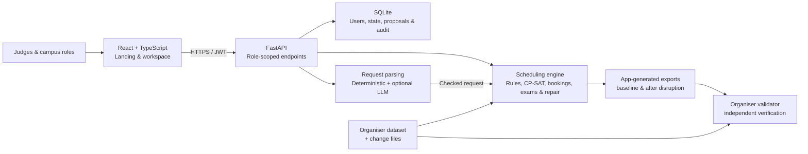

<div align="center">
  

  # Tessera

  **A clearer way to plan a campus week.**

  Timetables, exams, venue requests and the changes in between—<br />
  brought together in one scheduling workspace.

  [Open the app](https://tessera-web-yahp.onrender.com) · [API documentation](https://tessera-api-sgie.onrender.com/docs) · [Quickstart](#quickstart) · [Validation](#verify-the-exports)

  Team **Voltryx** &nbsp;·&nbsp; Tech Zephyr 4.0 &nbsp;·&nbsp; Chilika Institute of Technology
</div>

---

Tessera turns the Chilika Institute of Technology (CIT) scheduling problem into a workflow: generate a timetable, seat exams, decide Spectra-week venue requests, and review repairs when the week changes. A constraint engine checks the rules; an optional language model helps interpret requests but **does not decide whether a schedule is valid**.

> **For judges:** Start with the [demo accounts](#demo-accounts) and the [five-minute walkthrough](#explore-the-demo). The hosted walkthrough video URL is **still pending**. Hosted services and demo accounts should be rechecked before submission; they have not been independently verified in this environment.

## At a glance

Results below are from the **committed app-generated exports** for the public `cit-public-v1` dataset, checked with the unmodified [organiser validator](vendor/validator.py). They are not claims about every possible dataset or disruption.

| Timetable | Spectra bookings | Midsem exams | Sample disruption |
| :--- | :--- | :--- | :--- |
| **189 / 189** sessions placed | **67 / 70** booking score | **41 / 41** papers placed | **12** existing sessions moved |
| **0** hard violations | 22 approved · 1 alternative · 2 rejected | **0** exam soft penalty | 3 time changes · 9 room-only |
| Soft penalty **3** | **0** priority inversions | Rooms at half capacity | **0** hard violations after repair |

The timetable's soft penalty is **3** (all from S4). Both the [baseline](exports/schedule.json) and [repaired export](exports/schedule_after.json) can be checked using the commands below. The official validator does not assess the added invigilator metadata; Tessera checks that separately. See the [test report](docs/CORE_TEST_REPORT.md) for scope and outstanding checks.

## What Tessera does

| Workflow | What you can do | Where to look |
| :--- | :--- | :--- |
| **Plan the week** | Generate a constraint-checked timetable and inspect it by group, faculty or room. | Mosaic Board · Availability · Operations |
| **Seat exams** | Allocate papers to rooms at half capacity and assign available invigilators. | Examinations |
| **Decide requests** | Review scored Spectra requests, alternatives, rejections and their reasons; check one-off manual events. | Bookings · [Public ledger](https://tessera-web-yahp.onrender.com/ledger) |
| **Repair a disruption** | Preview a change, inspect the proposed moves and have a different admin approve it. | Approvals |
| **Ask in plain language** | Turn English or Hinglish into a reviewable request, with a deterministic path when the optional model is unavailable. | Bookings · Tessera Intelligence |
| **Inspect and export** | Review conflicts and utilisation, load a dataset, reset demo state and download schedule files. | Overview · Reports · Operations |

### The decision boundary

A language model can help **read** a request; it cannot approve a booking, invent a policy or bypass validation. Parsed data is checked against the dataset and the application's rules before a change can proceed. The default `LLM_PROVIDER=none` keeps the deterministic parser and manual form available without an API key. See [AI_USAGE.md](AI_USAGE.md) for models, prompts and AI use.

## Explore the demo

| Resource | Link / status |
| :--- | :--- |
| App | [tessera-web-yahp.onrender.com](https://tessera-web-yahp.onrender.com) |
| API | [Swagger UI](https://tessera-api-sgie.onrender.com/docs) · [health endpoint](https://tessera-api-sgie.onrender.com/health) |
| Video walkthrough | **Needs attention:** upload a ≤5-minute walkthrough and add its publicly viewable URL here. |
| Exports | [Baseline](exports/schedule.json) · [After sample disruption](exports/schedule_after.json) |

The Render free service may sleep when idle, so allow time for a cold start. If the API is unreachable, the frontend can show a labelled **snapshot**; snapshot interactions do not persist changes to the scheduler. Use a live API connection to evaluate writes, approvals and exports.

### Demo accounts

The default demo password for these accounts is **`Tessera@2027`**. They are seeded on a fresh backend database; deployment configuration can change these values.

| Role | Email | Try this |
| :--- | :--- | :--- |
| Admin · proposer | `admin@cit.edu` | Generate and validate a timetable; preview a disruption. |
| Admin · second approver | `dean@cit.edu` | Review a proposal submitted by the first admin. |
| Department coordinator | `dept.cse@cit.edu` | Inspect department activity and request permitted changes. |
| Faculty | `faculty@cit.edu` | View the timetable and request a change to an assigned session. |
| Club representative | `club@cit.edu` | Review venue requests and submit a manual event. |

One-click demo identities are enabled by default. This is **demo-only**: outside a demo, set `DEMO_LOGIN_ENABLED=false`, replace the demo password and configure a strong `JWT_SECRET`. Sign-out revokes the presented token when the API is reachable; if it is not, the client clears the session but the token remains valid until expiry.

### A short judge's path

1. Sign in as **admin** and open **Mosaic Board**. Switch between group, faculty and room views; select a session to inspect it.
2. Open **Bookings** to review the Spectra decisions and reasons. Try a plain-language request, review the parsed details and check a slot.
3. Open **Approvals → Load sample disruption** to preview the repair and its before/after moves. The preview does not apply the change.
4. Sign out and sign in as the **second admin** to approve the first admin's proposal. An admin cannot approve their own proposal.
5. Open **Operations** to generate, validate, download exports or **Reset demo data**. Reset affects the active demo state, so use it deliberately.

A fuller script is in [docs/DEMO.md](docs/DEMO.md); edit and rehearse it to fit the required video length.

## Architecture



- **Constraint engine:** `api/app/core/constraints.py` checks scheduling rules independently of the organiser's validator. CP-SAT models generate timetables, exam seating and repairs.
- **Approval boundary:** disruption previews produce proposals; a different administrator must approve an applicable change. Confirmed manual bookings are considered during repair and rechecked before approval.
- **Persistence:** SQLite stores users, active state, proposals, audit records and the AI budget. Hosting with an ephemeral filesystem can lose changes on restart; configure persistent storage when state must survive.
- **Independent evidence:** `vendor/` holds the organiser's dataset and validator, unmodified. Validator results and operational checks have different scopes.

### Technology

| Layer | Stack |
| :--- | :--- |
| Frontend | React 18 · TypeScript · Vite · React Router · CSS |
| API & persistence | Python 3.11 · FastAPI · Pydantic · SQLModel / SQLite · JWT |
| Optimisation | Google OR-Tools CP-SAT |
| Optional AI | Groq provider with a deterministic parsing path |
| Quality | pytest · TypeScript checks · jsdom frontend smoke · organiser validator |
| Deployment | Render static frontend + Python API; see [render.yaml](render.yaml) |

## Quickstart

**Prerequisites:** Python 3.11, Node.js **22.15 or newer** and npm. Run the commands from the repository root unless stated otherwise. No AI key is required for the default path.

### 1. Install and run the API

**macOS / Linux**

```bash
python3 -m venv .venv
source .venv/bin/activate
pip install -r api/requirements.txt
sh tools/setup_env.sh
cd api
uvicorn app.main:app --reload --port 8000
```

**Windows PowerShell**

```powershell
python -m venv .venv
.\.venv\Scripts\Activate.ps1
pip install -r api\requirements.txt
Copy-Item .env.example .env  # skip if .env already exists
cd api
python -m uvicorn app.main:app --reload --port 8000
```

API health: <http://localhost:8000/health> · interactive documentation: <http://localhost:8000/docs>. The API loads the committed schedule by default; generating a new one is an explicit action.

### 2. Run the frontend

Open a **second terminal**, from the repository root:

```bash
cd frontend
npm ci
npm run dev
```

Open <http://localhost:5173>. Vite proxies API requests to port 8000 by default. If your API runs elsewhere, set `TESSERA_API` when starting Vite. The frontend can also render the bundled snapshot when the API is offline, but writes then remain previews.

### Configuration

Copy [`.env.example`](.env.example) to `.env` (the setup script does this without overwriting an existing file). Environment variables take precedence over `.env`.

| Variable | Purpose |
| :--- | :--- |
| `DATABASE_URL` | SQLite database location. |
| `DATASET_PATH`, `EXPORTS_DIR` | Dataset and output locations; relative paths resolve from the repo root. |
| `DEMO_LOGIN_ENABLED`, `DEMO_PASSWORD` | Demo identity access and seeded password. |
| `JWT_SECRET` | Signing secret; replace the development value outside a local demo. |
| `SOLVER_SEED`, `SOLVER_WORKERS`, `SOLVER_TIME_LIMIT`, `REPAIR_TIME_LIMIT` | Solver configuration and time limits. |
| `LLM_PROVIDER`, `GROQ_API_KEY` | Optional provider; leave `LLM_PROVIDER=none` to work without a key. |
| `CORS_ORIGINS`, `WEB_APP_URL` | Browser origins and frontend URL for a split deployment. |
| `VITE_API_BASE`, `TESSERA_API` | Frontend API base for deployment, or Vite's local proxy target, respectively. |

Never commit real credentials. For an optional Groq key, use `python tools/set_groq_key.py` or set a private environment variable; see [docs/SECRETS.md](docs/SECRETS.md).

## Verify the exports

From the repository root, run the organiser's validator directly. It uses only Python's standard library.

```bash
python vendor/validator.py --data vendor/cit_public.json \
  --schedule exports/schedule.json

python vendor/validator.py --data vendor/cit_public.json \
  --schedule exports/schedule_after.json \
  --disruption vendor/sample_disruption.json \
  --baseline exports/schedule.json
```

For the committed files, both report **0 hard violations**, soft penalty **3**, booking score **67/70** and exam soft penalty **0**. The second command also reports **12 sessions moved**. See [docs/validation-report.json](docs/validation-report.json) and [docs/validation-report-after.json](docs/validation-report-after.json) for saved reports; rerun the validator after changing exports.

### Regenerate with the app

These commands **overwrite the two files in `exports/`**. From the repo root, with backend dependencies installed:

```bash
cd api
python -m app.core.pipeline --data ../vendor/cit_public.json \
  --out ../exports/schedule.json \
  --after ../exports/schedule_after.json \
  --disruption ../vendor/sample_disruption.json \
  --workers 2 --time-limit 120
cd ..
```

The pipeline generates the baseline, applies the sample disruption to that baseline and writes the repaired export. Re-run both validator commands above. Solver output and runtime can vary with configuration, hardware and parallel search. For example, a fresh local run with two workers produced a valid repair with 13 moves; the 12-move result above refers to the committed exports. Do not hand-edit exports or organiser files.

### Tests

```bash
# Backend, from the repository root with .venv activated
cd api && python -m pytest tests -q

# Frontend, from another terminal at the repository root
cd frontend && npm ci && npm run build && npm run smoke

# From the repository root
python tools/check_secrets.py
```

The last documented full backend run passed **115 tests**. Frontend smoke uses jsdom and a snapshot by default; it is not a substitute for testing the deployed app on real browsers. See [docs/CORE_TEST_REPORT.md](docs/CORE_TEST_REPORT.md) for measured results and limitations.

## Known limitations & submission checks

- **Manual request priority:** the public dataset's scored bookings follow the published priority order, but competing new manual events do not yet have a priority queue or admin-approved preemption workflow. Confirmed events are protected.
- **Exam assumptions:** the app assigns one invigilator per room and conservatively applies weekly room/faculty unavailability to the separate exam week by clock overlap. The organiser dataset does not specify a staffing ratio or week-specific exceptions; confirm these assumptions.
- **Deployment and devices:** the deployed frontend/API, all hosted demo accounts, a real external AI call, an actual mobile browser and private judge datasets still need independent verification. Free hosting can cold-start and may use ephemeral storage.
- **Video:** the required ≤5-minute hosted walkthrough URL is missing. Verify that it is viewable without an access request.
- **Security:** passwordless demo login is enabled by default. Disable it and replace demo credentials and the development JWT secret outside the demo.
- **Scope:** one active institution/dataset at a time; the assistant is grounded in the workspace rather than a general-purpose campus knowledge base.

## Repository guide

```text
frontend/             React landing page and scheduling workspace
api/app/core/         Dataset, constraints, solvers, exams, bookings, repair and export
api/app/routers/      FastAPI endpoints
api/app/ai/           Parsing, provider integration and budget guard
api/tests/            Backend regression and validator-parity tests
exports/              App-generated baseline and repaired schedules
vendor/               Organiser dataset, validator and sample disruption (read-only)
prompts/              Versioned product prompts
docs/                 Rulebook, API, architecture, test report and demo notes
tools/                Setup and verification utilities
```

**Further reading:** [Rules master](docs/RULES_MASTER.md) · [Organiser starter pack](CrunchWeek_StarterPack%20%281%29/CrunchWeek_StarterPack/README.md) · [API reference](docs/API.md) · [Repair design](docs/REPAIR.md) · [Database](docs/DATABASE.md) · [Test report](docs/CORE_TEST_REPORT.md) · [AI usage](AI_USAGE.md) · [Third-party declarations](THIRD_PARTY.md)

---

<div align="center">
  Built by <strong>Team Voltryx</strong> for Tech Zephyr 4.0.<br />
  <sub>Better weeks begin with the details.</sub>
</div>
